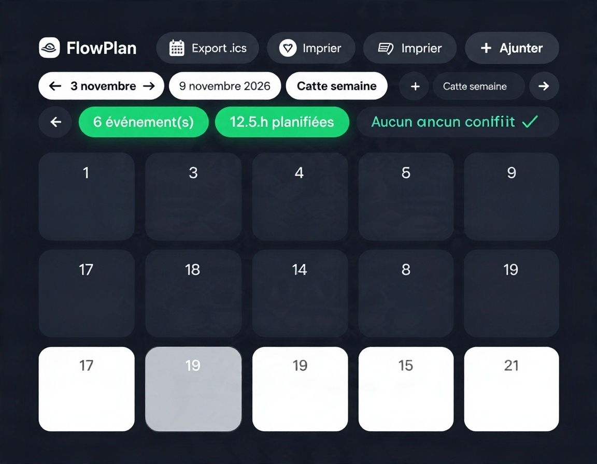

# FlowPlan — Planning interactif

Tu décris ta semaine en français (texte ou voix), FlowPlan génère ton planning visuel.
**100 % local** : tes données restent sur ton appareil, aucun compte, aucun serveur externe.

## Aperçu




## Trois façons de l'utiliser

| Plateforme | Comment lancer |
|---|---|
| **Web** (navigateur) | `npm run serve` puis ouvrir http://localhost:8000 |
| **Téléphone** (app installable) | héberge le dossier n'importe où en HTTPS, ouvre l'URL, « Ajouter à l'écran d'accueil » (PWA, fonctionne hors-ligne) |
| **Ordinateur** (logiciel) | `npm install && npm start` (Electron, Windows/macOS/Linux) |

## Commandes (Windows PowerShell)

```powershell
cd apps\flowplan
npm install        # installe Electron (uniquement pour la version bureau)
npm test           # 29 tests, zéro dépendance
npm run serve      # version web : http://localhost:8000
npm start          # version bureau (Electron)
npm run dist:win   # fabrique l'installeur Windows (release\*.exe)
```

Sans Electron (juste le web) : `node serve.js` suffit, aucune installation.

## Ce que comprend le parser (français)

- Jours : `lundi`, `mardi 14h30`, `tous les lundis 18h sport`, `tous les jours 7h réveil`
- Dates : `aujourd'hui`, `demain`, `12 mai 2026`, `05/12/2026`
- Heures : `9h`, `14h30`, `14:30`, plages `18h à 20h`, durées `pendant 2h` (sinon 1h par défaut)
- Journée entière : aucune heure indiquée
- Plusieurs événements à la fois : sépare par `;` ou `puis`

## Fonctionnalités

- Génération du planning semaine à partir d'une phrase
- Saisie **vocale** (🎙️, Web Speech API, fonctionne dans Chrome/Edge)
- Catégories automatiques (travail, sport, santé, perso, courses, études) avec couleurs
- Détection de **conflits** (chevauchements)
- Statistiques de la semaine (nb événements, heures planifiées)
- Navigation entre les semaines, édition/suppression par clic sur un événement
- **Export .ics** (importable dans Google Agenda, Outlook, Apple Calendrier)
- Impression de la semaine (CSS print dédié)
- PWA installable + service worker hors-ligne
- Version bureau Electron (sandbox, contextIsolation, CSP stricte)

## Architecture

```
index.html          page unique
css/app.css         thème NovaLoom (sombre)
js/parser.js        phrase FR -> événements (testé en Node)
js/planner.js       moteur : ajout, tri, semaine, conflits, stats
js/store.js         persistance localStorage (100 % local)
js/voice.js         saisie vocale (Web Speech API)
js/categories.js    catégorie auto d'après le titre
js/ics.js           export calendrier .ics
js/app.js           UI
serve.js            serveur statique zéro dépendance (web/PWA)
main.js/preload.js  shell Electron (bureau)
sw.js               service worker (hors-ligne)
tests/run-tests.js  29 tests : node tests/run-tests.js
```

## Confidentialité

Aucune donnée ne quitte l'appareil : pas de compte, pas de télémétrie, pas d'API externe.
La reconnaissance vocale passe par le navigateur (Web Speech) ; le texte reconnu reste local
sauf si le navigateur envoie lui-même la voix à son service (hors de notre contrôle — Chrome/Edge uniquement).

## Build bureau

```powershell
npm run dist:win   # -> release\FlowPlan Setup *.exe + portable
```
